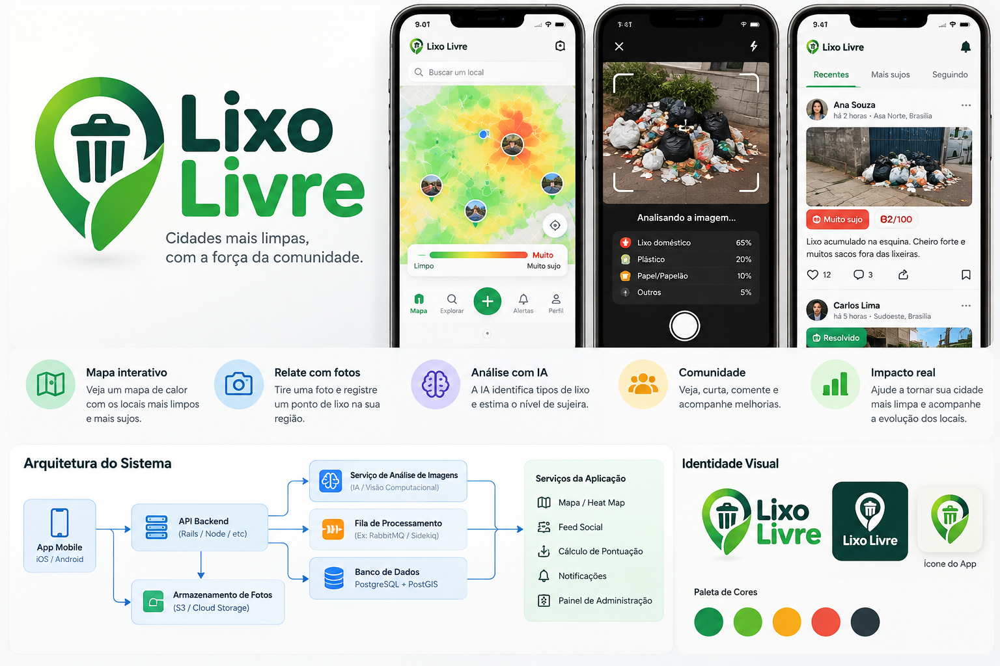
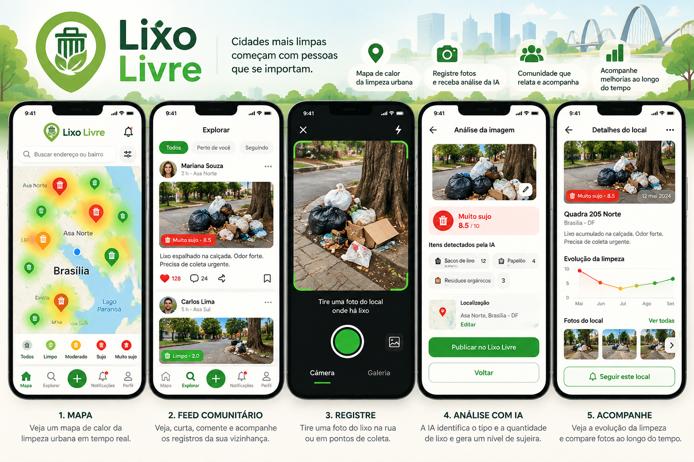

# Lixo Livre

*Cidades mais limpas, com a força da comunidade.* (Cleaner cities, powered by the community.)

Heatmap of how dirty each neighborhood is, built from photos people take of trash.





The top of the board shows the five app screens, the bottom strip shows how it works. The screens:
**1. Map** (real-time heat map of urban cleanliness), **2. Community feed** (see, like, comment and follow
reports from your neighborhood), **3. Report** (take a photo of the trash), **4. AI analysis** (the AI identifies
the type and amount of trash and gives a dirtiness level) and **5. Follow-up** (see how a spot changes over
time and compare photos).

How it works: **you report** (a photo plus the location) → **the AI analyzes** (trash types and a dirtiness
level) → **the map updates** (the spot adds to the urban heat map) → **the community takes part** (like, comment,
follow the improvements) → **cleaner cities**.

In this repo the severity scale is 0-100 (the mock-ups show 8.5/10); see [Severity scale](#severity-scale).

## Product concept

The board above is the product vision. The mobile app has three main views:

- **Map (home):** heatmap from *Limpo* (green) to *Muito sujo* (red), a place search box, photo pins on hotspots,
  and a big **+** button to report trash. Bottom tabs: Mapa, Explorar, Alertas, Perfil.
- **Camera / AI analysis:** take a photo and the AI breaks it down by trash type with percentages
  (for example household waste 65%, plastic 20%, paper/cardboard 10%, other 5%).
- **Social feed:** tabs *Recentes*, *Mais sujos*, *Seguindo*. Each post has the photo, location, a
  dirtiness badge with a score out of 100 (for example 82/100), a description, likes, comments and share,
  and a *Resolvido* (cleaned up) status.

Brand colors: two greens, amber, red, and dark slate (green to red also drives the heatmap ramp).

### Board architecture vs. this repo

| Board | In this repo |
|---|---|
| App mobile (iOS / Android) | `mobile/` placeholder (React Native + Expo) |
| API backend (Rails) | `api-overlay/` (done) |
| Image analysis service (AI / computer vision) | `TrashVision` (vendor-neutral, plug in any provider) + `ValidateTrashJob` |
| Processing queue (RabbitMQ / Sidekiq) | Active Job. In-process async queue in the Railway demo; plug in Sidekiq or Solid Queue for real load |
| Database (PostgreSQL + PostGIS) | done |
| Photo storage (S3 / Cloud Storage) | Active Storage, configure S3 or R2 |
| Map / heat map | `HeatCell` + `GET /heatmap` (done). The API serves a small MapLibre demo page at `/`; the full React app comes later |
| Social feed, score calculation, notifications, admin panel | not built yet, see roadmap |

### Roadmap from the board

These appear on the board but are not in the data model yet:

- **Trash type percentages:** `trash_types` is a list of labels. Add a `trash_breakdown` jsonb
  (type to percent) if the camera screen should show the split.
- **Resolved status:** a `Cleanup` record (or `resolved_at` on `Trash`) so cleaned spots stop heating the map.
- **Likes, comments, follows:** `Like`, `Comment`, `Follow` models, and a feed endpoint with *Recentes* and *Mais sujos* ordering.
- **Notifications (Alertas):** push tokens on `Device`, plus notification jobs.
- **Place search and Explorar:** geocoding for the search box.
- **Admin panel:** moderation of `needs_review` reports and pending flags.
- **Login:** the social features need real accounts, so `Device#claim_by!` moves the anonymous history over.

## Repository layout

```
lixo-livre/
  api/           Rails API (generated by setup.fish)
  api-overlay/   Our code, copied over the generated Rails app by setup.fish
  deploy/        Docker build script (generates the Rails app when api/ is not committed)
  tools/         Helper scripts (app patcher, fixture and demo photo generators)
  docs/          Concept board, Railway guide
  web/           React + Vite + MapLibre heatmap (later)
  mobile/        React Native + Expo photo-report app (later)
```

## Run it

Needs Ruby 3.3+, PostgreSQL with PostGIS, and libvips (photo processing):

No PostGIS installed? `docker compose up -d db` starts one (see `docker-compose.yml`).

```fish
brew install postgis vips                                     # macOS
sudo apt install postgresql-16-postgis-3 libvips42            # Ubuntu
```

```fish
./setup.fish
cd api
bin/rails server
```

`setup.fish` runs `rails new api --api -d postgresql`, switches the adapter to `postgis`,
adds the gems (`activerecord-postgis-adapter`, `h3`, `rack-cors`, `rack-attack`, `image_processing`, `ruby-vips`),
installs Active Storage, copies `api-overlay/` on top, then runs `db:create db:migrate`.
If `h3` fails to build, install `cmake` and retry.

Load fake data and open the demo map at <http://localhost:3000>:

```fish
bin/rails demo:seed        # about 220 fake reports in 5 dirty areas around Brasilia (DEMO_CENTER to move them)
bin/rails demo:reset       # remove only the fake data
```

## Deploy on Railway (with fake data)

The repo has a `Dockerfile` and `railway.toml`, so Railway builds and starts it as it is. With
`DEMO_MODE=true` and `SEED_DEMO_DATA=true` you get a public URL with a map, fake reports and photos,
and a working upload endpoint, without any AI provider. Step by step in
[docs/DEPLOY_RAILWAY.md](docs/DEPLOY_RAILWAY.md).

Demo mode uses a fake AI and a detector that blurs nothing. Do not point real users at it.

## Accounts and login

Anyone can see the map. **Reporting needs an account**: the + button only appears when logged in, and `POST /trashes` and `/me/*` answer 401 `login_required` otherwise. The page is three swipeable screens, **Explorar** (left, the community feed, coming next), **Mapa** (middle) and **Perfil** (right); on the map, swipe from the very edge of the screen, or use the bottom tabs.

| Way in | How it works |
|---|---|
| Email + password | Devise keeps the account and the encrypted password. The session is an HttpOnly, SameSite=Lax cookie. |
| Google | The "Sign in with Google" button gives the page an ID token; the server checks it with Google (right app, verified email) and creates or links the account. Set `GOOGLE_CLIENT_ID`. |
| Fingerprint / face | Passkeys (WebAuthn). Logged in, tap *Ativar biometria neste aparelho* in Perfil; next time, *Entrar com biometria* needs no email. The server only stores a public key. |
| Instagram | Not offered: Meta shut down the API that let ordinary accounts log in. Facebook login could be added later. |

Roles are `user`, `moderator`, `admin`. Emails listed in `ADMIN_EMAILS` become admins at sign-up or next login, or run `bin/rails users:promote EMAIL=...`. The role is exposed to the page (`admin: true`) and `require_admin!` is ready for admin endpoints; admins and moderators get a **Moderação** button in Perfil: held reports (photo taken far from the pin, AI unsure, technical failure) with a severity slider and *Aprovar e publicar* / *Rejeitar*, and photos people flagged (*Manter* / *Remover*). A photo whose privacy step never finished is never shown, even to admins, and cannot be approved.

Writes from another website are refused (`Origin` check, plus SameSite cookies). The first time a logged-in person reports from a device that nobody owns, the device (and its earlier anonymous reports) becomes theirs.

## Severity scale

The AI gives each report a `severity` from **0 (spotless) to 100 (large illegal dump)**. The AI judges it from the amount of trash, how far it is spread and how many different kinds are mixed. Rough guide: about 20 a few
items, 50-70 a clear pile or a lot of mixed loose litter (bags are not required; organic waste counts fully), 80 or more a big dump, bulky waste or a hazard. The wording lives in `TrashVision::PROMPT`. The UI labels it in bands of 20 (*Muito leve*,
*Leve*, *Moderada*, *Grave*, *Muito grave*). A heat cell's `score` is the sum of its reports' severity, halved every
14 days. Vendors that think in 1-5 stars need to convert in their adapter: `TrashVision` accepts any 0-100 value, so a 4 would be read as "almost spotless".

## Data flow

1. Mobile creates an anonymous device (`POST /devices`) and keeps the token.
2. Mobile uploads a photo with GPS and `taken_at` (`POST /trashes`). It starts as `pending` and is not public.
3. `SanitizePhotoJob` makes the photo safe (see [Photo privacy](#photo-privacy)) and deletes the original.
4. `ValidateTrashJob` shows the sanitized photo to the AI (`app/services/trash_vision.rb`), which decides if
   it is trash and sets `severity` (0-100) and `trash_types`, or sends it to `needs_review`.
5. Validated reports re-score their H3 cell (`RefreshHeatCellJob`). A nightly job applies time decay.
6. Web reads `GET /heatmap` for the colored layer and `GET /trashes` for the photos of a clicked spot.

## Photo privacy

Photos carry personal data: GPS and camera info in the EXIF block, faces and license plates in the pixels.
Every upload goes through `SanitizePhotoJob` before the AI, the map or the mobile feed can see it:

- **Rebuilt from pixels.** The photo is decoded, rotated upright, converted to sRGB, shrunk to 2048 px and
  re-encoded as a new JPEG, so nothing from the original file survives by accident (XMP, IPTC, ICC, previews).
- **EXIF kept, cleaned.** The stored photo keeps its GPS position, capture time, camera make and model, lens and
  basic shooting settings (`ExifPreserver`). It is a brand new EXIF block built from that allowlist, so it has
  **no embedded preview image** (that preview comes from the unblurred original and would bring a face back), no
  maker note, no serial number, owner name or description. Orientation is reset to 1 and the pixel size updated.
  Set `STRIP_PHOTO_METADATA=true` to store photos with no EXIF at all.
- **Faces and plates blurred.** A detector (`PrivacyDetector`) returns regions; each becomes a 6x6 mosaic
  (padded 20% so box edges are covered). The detector and the AI vendor only receive metadata-free pixels, so no GPS
  or device info reaches a third party.
- **Original deleted.** The stored file is replaced; the old blob is purged.
- **Fail closed.** If sanitizing cannot finish (detector down, ...) the report goes to `needs_review` and stays
  private. An unsanitized photo is never shown, never sent to the AI, and `/me/trashes` does not link it.
- **EXIF is cross-checked.** Before sanitizing, we read the capture time and GPS and record the comparison
  (`photo_meta`: `exif_taken_at`, `exif_distance_m`, `redactions`, `metadata_kept`). A photo whose EXIF position is
  over 1 km from the reported spot, or whose capture time is over 2 days off, goes to `needs_review` instead of
  the map (no AI cost).
- Uploads must be JPEG, PNG, WebP or HEIC and at most 15 MB; unreadable files are rejected and deleted.

Keeping the EXIF means **anyone who opens a public photo URL can read where it was taken and with which
camera**, exactly where the person stood. That is exposed on every report the map shows. If that is not what you
want for real users, set `STRIP_PHOTO_METADATA=true`: the position is still used for the map and the cross-check, it
just is not repeated inside the image file.

### Plugging in a face and plate detector

`PrivacyDetector.provider` is a callable. It gets JPEG bytes and returns regions in normalized
coordinates (0.0-1.0, origin top-left):

```ruby
# config/initializers/privacy_detector.rb
PrivacyDetector.provider = lambda do |jpeg_bytes|
  # Call your detector here: AWS Rekognition (DetectFaces + DetectText for plates),
  # Google Cloud Vision (face detection + object localization), or a self-hosted model.
  [
    { kind: "face",          x: 0.40, y: 0.10, width: 0.08, height: 0.12 },
    { kind: "license_plate", x: 0.55, y: 0.70, width: 0.10, height: 0.04 }
  ]
end
```

Return `[]` only when the detector looked and found nothing. If it cannot answer, **raise**: the report is
held for review instead of being published unblurred. In development and test the default detects nothing;
anywhere else it raises until you configure a provider, so a fresh deployment cannot publish photos by accident.

Detectors miss things (small, angled or partly hidden faces and plates). Treat the blur as a strong default, not
a guarantee: keep the flag button, and show moderators only sanitized photos (`sanitized_at` present).

### Publishing

Reports are approved for the heatmap **by the AI score**, with no manual step (`AUTO_PUBLISH` defaults to on):

| AI confidence | Result |
|---|---|
| 0.8 or more | published, full weight |
| 0.6 to 0.8 | published, weight x0.6 |
| below 0.6 | held for moderation |

Cell score (`HeatScore`): reports decay with a 14-day half-life; one report per person per day counts; each extra
person confirming adds 15% (up to +45%); a person's repeats do not add up.
**Cleanup reports** (`POST /trashes` with `kind=cleanup`, button "Já foi limpo"): the AI must see a clean place
(severity <= 15, confidence >= 0.8) and the cell must have recent dirty reports; then earlier reports stop counting
and the cell shows as cleaned for 30 days (`cleaned: true`). Rejections come back as stages `still_dirty` /
`nothing_to_clean`. An author can withdraw a published report (`DELETE /me/trashes/:id`), which re-scores the cell.
Set `AUTO_PUBLISH=false` to restore the manual **Publicar** step.

### Privacy: faces, plates and consent

With `TRASH_VISION_PROVIDER=anthropic` the same Claude key also finds faces and license plates (`PrivacyDetector::Anthropic`, `PRIVACY_DETECTOR=none` to disable) before a photo can be published; if it fails, the photo stays private for review. Sign-up requires accepting the Terms and Privacy Policy (`POST /users` and a new Google account need `accepted_terms: true`; the version and date are stored; `POST /consent` for older accounts; reporting returns 403 `terms_required` until accepted). `DELETE /api/v1/account` deletes the account and its reports. `bin/rails db:backup` uploads a database dump to a bucket (see docs/DEPLOY_RAILWAY.md).

### Plugging in an AI provider

**Ready-made (no code):** set environment variables and redeploy.

| Provider | Variables |
|---|---|
| Claude (Anthropic) | `TRASH_VISION_PROVIDER=anthropic`, `ANTHROPIC_API_KEY`, optional `TRASH_VISION_MODEL` (default `claude-sonnet-5-5`; `claude-haiku-5-5` is cheaper) |
| OpenAI or any OpenAI-compatible server | `TRASH_VISION_PROVIDER=openai`, `OPENAI_API_KEY`, `TRASH_VISION_MODEL` (required, a model that accepts images), optional `OPENAI_BASE_URL` |

The adapters live in `app/services/trash_vision/adapters/` and use plain `Net::HTTP`, with no extra gems. The photo
they send has no EXIF. A provider set this way is used even with `DEMO_MODE=true`, so you can try a real AI on fake
data. **Note:** `DEMO_MODE` still turns face and plate blurring off; do not accept real users until `PrivacyDetector`
is wired in. A failing call (bad key, rate limit, timeout) is retried, then the report goes to `needs_review`.

**Comparing providers on your own photos:** put some photos in a folder and run, from `api/`:

```
ANTHROPIC_API_KEY=... GEMINI_API_KEY=... GEMINI_MODEL=<a Gemini Flash model> \
  bin/rails vision:compare DIR=../photos PROVIDERS=anthropic,gemini
```

It prints one row per photo with each provider's severity, types, confidence and time, so you can see which one
agrees with your own scores. Providers: `anthropic`, `gemini`, `openai` (each reads its own key and model variables,
see `lib/tasks/demo.rake`).

**Your own vendor:** `TrashVision` knows no vendor. Give it anything that responds to `call`, in an initializer:

```ruby
# config/initializers/trash_vision.rb
class MyVisionAdapter
  def call(image)                       # image: TrashVision::Image (bytes, content_type, base64, data_uri)
    reply = MyVendor.ask(prompt: TrashVision::PROMPT,
                         schema: TrashVision.json_schema,
                         image: image.data_uri)
    JSON.parse(reply)                   # { "is_trash" => true, "severity" => 72, "types" => ["plastic"], "confidence" => 0.92 }
  end
end

TrashVision.provider = MyVisionAdapter.new
```

The answer can be a Hash (string or symbol keys) or a `TrashVision::Result`. Before the app uses it,
`TrashVision.normalize` checks it: `is_trash` must be a boolean, `severity` an integer 0-100, `confidence`
0-1; unknown `types` are dropped. A bad answer raises `TrashVision::InvalidResponse`, the job retries, and
then the report goes to `needs_review`, so a confused provider never publishes anything. Switching vendors
means writing a new adapter and nothing else.

## API

| Method | Path | Used by | Purpose |
|---|---|---|---|
| POST | `/api/v1/devices` | mobile | Returns the anonymous token |
| GET | `/api/v1/session` | web | Who is logged in: `{ "user": { id, name, email, role, admin, passkeys, google } }` or `{ "user": null }` |
| POST | `/api/v1/users` | web | Sign up: `name`, `email`, `password` (8+ characters). Logs in |
| POST | `/api/v1/session` | web | Log in with `email` and `password` (401 `invalid_credentials`) |
| DELETE | `/api/v1/session` | web | Log out |
| POST | `/api/v1/session/google` | web | Log in with the `credential` from "Sign in with Google" (needs `GOOGLE_CLIENT_ID`) |
| POST | `/api/v1/passkeys/authentication_options`, `/passkeys/authenticate` | web | Log in with fingerprint / face (WebAuthn), no email needed |
| POST | `/api/v1/passkeys/registration_options`, `/passkeys` | web | Logged in: add a passkey to this account |
| GET, DELETE | `/api/v1/passkeys`, `/api/v1/passkeys/:id` | web | List and remove this account's passkeys |
| GET | `/api/v1/admin/reviews` | admin | Moderation queue: `held` (reports the pipeline would not publish) and `flagged` (published photos people reported) |
| POST | `/api/v1/admin/reviews/:id/approve` | admin | Held: `{ severity: 0-100 }` publishes it. Flagged: keeps it and dismisses the flags |
| POST | `/api/v1/admin/reviews/:id/reject` | admin | Held: rejects it and deletes the photo. Flagged: takes it down |
| GET | `/api/v1/status` | demo page, monitors | Demo flag, map center, counts |
| GET | `/api/v1/heatmap?bbox=w,s,e,n` | web | GeoJSON cells in the viewport |
| GET | `/api/v1/places/:h3_index` | web | One map cell: latest report, monthly cleanliness history, photos |
| GET | `/api/v1/heatmap?bbox=&days=7\|30\|90&type=plastic` | web | Same as before; `days` / `type` re-score the cells live from the matching reports (`HeatQuery`); each feature has a `trend` (`worse` / `better` / `stable`, 14-day change) |
| GET | `/api/v1/rankings?lat=&lng=&radius_km=` | web | Worst places around a point (score, trend, distance) and regions (H3 res 7) ranked by average score |
| GET / POST / DELETE | `/api/v1/follows`, `/api/v1/follows/:h3_index` | web (login) | Follow a place; `places/:h3` also returns `following` and `trend` |
| GET / POST | `/api/v1/notifications`, `/api/v1/notifications/read` | web (login) | In-app alerts when a followed place gets worse (+15 points) or is cleaned; `unread` count |
| GET | `/api/v1/trashes?lat=&lng=&radius=` | web, mobile | Photos near a point |
| GET | `/api/v1/trashes/:id` | both | One report |
| POST | `/api/v1/trashes` | mobile | Upload photo + `lat`, `lng`, `taken_at`, `extra_info` |
| GET | `/api/v1/me/trashes` | mobile | "My pictures" feed (all AI statuses) |
| GET | `/api/v1/me/feed` | web | The logged-in account's own reports from any device, newest first (up to 90), each with `thumb_url` (360px square) for the profile grid |
| GET | `/api/v1/me/trashes/:id` | mobile, demo page | Poll one report after upload: `stage` (`protecting_photo` → `analyzing` → `scored` / `not_trash` / `in_review`; after publishing, `published`), `done`, `severity` |
| POST | `/api/v1/me/trashes/:id/publish` | analysis screen | "Publicar no Lixo Livre": puts a scored report on the map (422 if it is not scored, or already published) |
| DELETE | `/api/v1/me/trashes/:id` | analysis screen | "Voltar" / "Excluir foto": deletes a report; if it was published it leaves the map and the cell is re-scored |
| POST | `/api/v1/trashes/:id/flags` | both | Report a bad or private photo |

After `POST /trashes` (202 with the new `id`), poll `GET /me/trashes/:id` every 1-2 seconds until `done` is true, then show
"Analyzing…" → the 0-100 `severity`. The demo page at `/` does exactly this (button "Reportar lixo").

Mobile requests send `X-Device-Token`. When login is added, call `device.claim_by!(user)` so the
anonymous history moves to the account.

## Before real users

- Turn `DEMO_MODE` off and wire in your AI provider: `TrashVision` and `PrivacyDetector` raise outside development, test and demo mode, and failed reports go to `needs_review`.
- Set `PrivacyDetector.provider` (see above). Without it, production holds every photo for review.
- Move photos to S3 or R2 (`ACTIVE_STORAGE_SERVICE=s3`, see the Railway guide), and commit `api/` so gem versions are pinned.
- Replace the in-process queue with a real worker (Sidekiq or Solid Queue).
- Add a moderator screen for `needs_review` reports and pending flags.
- A moderator or admin role exists on `User` but nothing enforces it yet.

## Tests

Minitest, run from the generated app (needs PostgreSQL with PostGIS and libvips):

```fish
cd api
bin/rails test                                    # everything
bin/rails test test/services/photo_sanitizer_test.rb   # one file
bin/rails test test/integration                   # API + end-to-end privacy pipeline
```

| Folder | Covers |
|---|---|
| `test/services` | `DemoMode`, `DemoPlan`, `DemoSeeder`, `PipelineRecovery`, `PhotoSanitizer` and `ExifPreserver` (EXIF kept but cleaned: no preview image, maker note or private fields; rotation, resize, alpha, mosaic where asked and nowhere else), `PhotoMetadata` (both byte orders, truncated and fuzzed input), `PrivacyRegion`, `PrivacyDetector`, `TrashVision`, `Geo` |
| `test/models` | validations, scopes, EXIF cross-check, flag auto-hide, heat score and decay, device claiming |
| `test/jobs` | `SanitizePhotoJob` (original deleted, retries, fail-closed), `ValidateTrashJob`, heat cell jobs |
| `test/integration` | every endpoint (including `/status` and the seeded demo data), plus `photo_privacy_pipeline_test.rb`: upload a photo with GPS in its EXIF and follow it to the map |

The AI and detector are replaced by fakes in `test/test_helper.rb` (`TrashVision.provider`,
`PrivacyDetector.provider`), so tests need no network and no API keys.

Image fixtures live in `test/fixtures/files` and are committed. To regenerate them (needs Pillow and numpy):
`python3 tools/generate_test_fixtures.py`.
